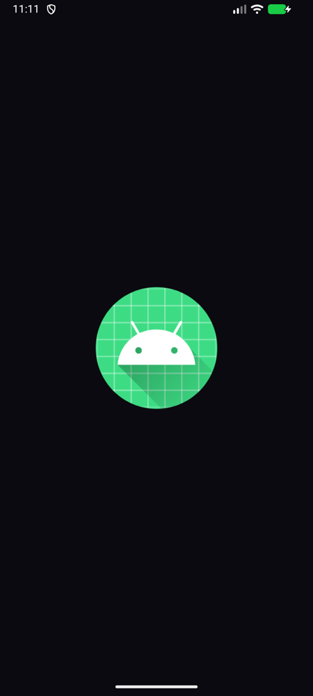
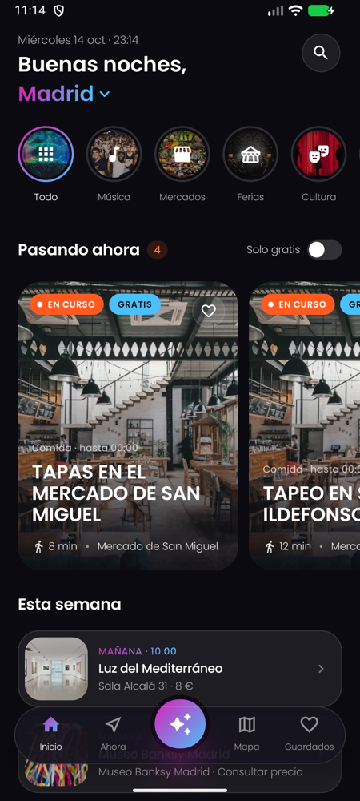
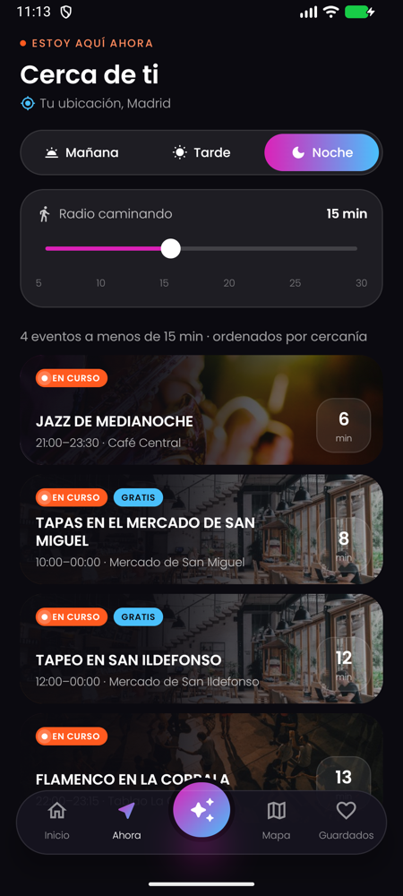
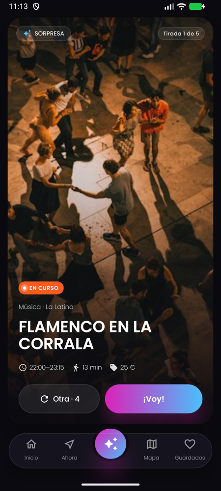
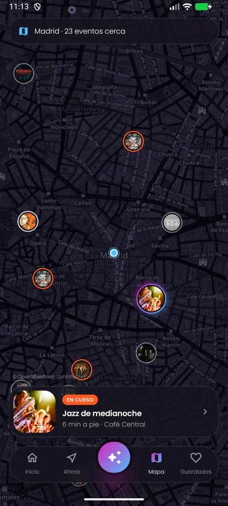
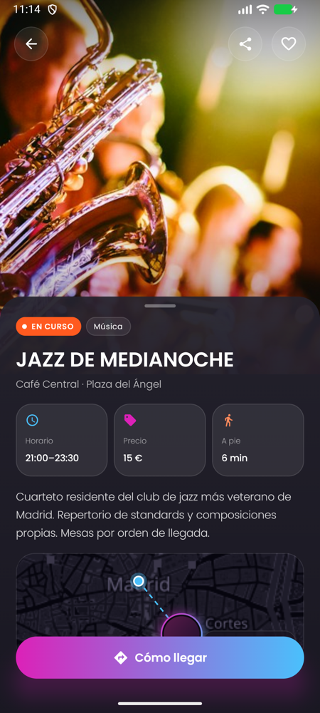
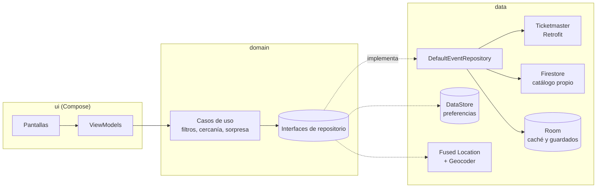

# CityPulse

Aplicación Android para viajeros que muestra **lo que está pasando ahora** en la ciudad: conciertos, mercados, ferias y actividades culturales, priorizando lo que queda cerca a pie y la hora del día.

Proyecto académico.

| Bienvenida | Inicio | Estoy aquí ahora |
|---|---|---|
|  |  |  |

| Sorpresa | Mapa | Ficha del evento |
|---|---|---|
|  |  |  |

## Funcionalidades

- **Ciudad por GPS o manual.** El permiso de ubicación se pide en la bienvenida; si se deniega, se puede elegir la ciudad en una lista con búsqueda que ignora las tildes.
- **Inicio.** Saludo según la hora, filtro por categoría (stories), interruptor *Solo gratis*, carrusel *Pasando ahora* (en curso o empieza en menos de 1 h) y lista *Esta semana*.
- **Estoy aquí ahora.** Eventos de la franja elegida (mañana, tarde o noche) a menos de *N* minutos a pie (5–30), ordenados por cercanía.
- **Sorpresa.** Un único evento al azar, en curso o que empieza en las próximas 3 h, a menos de 30 min. Máximo 5 tiradas al día y sin repetir.
- **Mapa.** OpenStreetMap en tonos oscuros con un pin por evento (anillo naranja si está en curso).
- **Ficha.** Hoja arrastrable con horario, precio, distancia, descripción, minimapa y botón *Cómo llegar* (Google Maps a pie).
- **Guardados.** Se conservan en el dispositivo y se pueden ver sin conexión.
- **Sin conexión.** Las pestañas que necesitan red muestran un aviso con acceso directo a Guardados.

## Arquitectura

MVVM en un solo módulo, organizado por capas. La UI solo conoce el dominio; las fuentes de datos se inyectan con Hilt.



- **Primero caché, luego red.** `DefaultEventRepository` emite al instante lo guardado en Room. Si la caché tiene más de 30 minutos, descarga de Ticketmaster y Firestore en paralelo, fusiona los resultados sin duplicados y la actualiza. Si una fuente falla, se conservan sus eventos anteriores.
- **Lógica pura y testeable** en `domain/`: franjas horarias, distancia (haversine × 1,3 por el trazado de las calles, a 80 m/min), filtros y selector Sorpresa.

```
com.citypulse
├─ core/designsystem/   tema, colores, Poppins y componentes (glass, badges, tarjetas, barra flotante…)
├─ domain/              modelos, interfaces de repositorio, casos de uso y lógica de tiempo y distancia
├─ data/                Ticketmaster, Firestore, Room, DataStore, ubicación y conectividad
├─ di/                  módulos de Hilt
└─ ui/                  una carpeta por pantalla (Screen + ViewModel) y la navegación
```

## Stack

Kotlin · Jetpack Compose + Material 3 · Navigation Compose (rutas tipadas) · Hilt · Retrofit + kotlinx.serialization · Room · DataStore · Coil · Fused Location Provider · osmdroid · Firebase Firestore · JUnit, MockK, Turbine y Compose UI Test.

## Fuentes de datos

- **Ticketmaster Discovery API**: conciertos y espectáculos alrededor del centro de la ciudad (15 km, próximos 7 días).
- **Catálogo propio en Firestore**: eventos gratuitos, mercados y ferias que no aparecen en Ticketmaster. Cada entrada es **recurrente** (días de la semana + horario, como "domingos de 9 a 15 h") o de una fecha concreta, y la app genera sus fechas para los próximos 7 días. Incluye datos de ejemplo de **Madrid** y **Bogotá**.

## Configuración

Requisitos: Android Studio con JDK 17 o superior, Android SDK 37 y un dispositivo con Android 8.0 (API 26) o superior.

### 1. Clave de Ticketmaster

Crea una cuenta en [developer.ticketmaster.com](https://developer.ticketmaster.com) y copia la *Consumer Key* de tu app en `local.properties`, que no se sube al repositorio:

```properties
TM_API_KEY=tu_clave_de_ticketmaster
```

La app funciona sin ella, pero solo mostrará el catálogo de Firestore.

### 2. Firebase

1. Crea un proyecto en [Firebase](https://console.firebase.google.com) y registra una app Android con el paquete `com.citypulse`.
2. Descarga `google-services.json` y colócalo en `app/` (no se sube al repositorio).
3. Crea una base de datos Firestore en modo de prueba.
4. Carga el catálogo de ejemplo:

   ```bash
   python3 scripts/seed_firestore.py
   ```

5. Publica las reglas de [`firestore.rules`](firestore.rules) (solo lectura) en Firestore → Reglas.

### 3. Mapa

El mapa usa las teselas estándar de OpenStreetMap con osmdroid, oscurecidas con un filtro de color. No necesita clave.

## Ejecutar y probar

```bash
./gradlew assembleDebug                 # APK en app/build/outputs/apk/debug/
./gradlew test                          # tests unitarios (dominio, datos y ViewModels)
./gradlew connectedDebugAndroidTest     # tests de interfaz (con emulador o móvil conectado)
```

## Decisiones y limitaciones

- **OpenStreetMap en lugar de Google Maps**: Google Maps exige una cuenta de facturación incluso dentro de su capa gratuita.
- **Zona horaria**: las horas de los eventos son las locales de la ciudad y se comparan con la hora del dispositivo. Si se consulta una ciudad con otra zona horaria, "en curso" se calcula con la hora del dispositivo.
- **Idioma**: la interfaz está en español. Los textos de las pantallas están en `strings.xml`; el formato de fechas y precios de las tarjetas (`ui/common/EventUi.kt`) también está en español.
- **Catálogo de ejemplo**: los eventos de Firestore son datos de demostración basados en lugares reales; sus horarios pueden no coincidir con la realidad.

## Créditos

- Tipografía [Poppins](https://github.com/itfoundry/Poppins) (SIL Open Font License, ver [docs/licenses](docs/licenses/Poppins-OFL.txt)).
- Mapas © [OpenStreetMap contributors](https://www.openstreetmap.org/copyright).
- Imágenes de los eventos de ejemplo: [Unsplash](https://unsplash.com).
- Datos de eventos: [Ticketmaster Discovery API](https://developer.ticketmaster.com).
